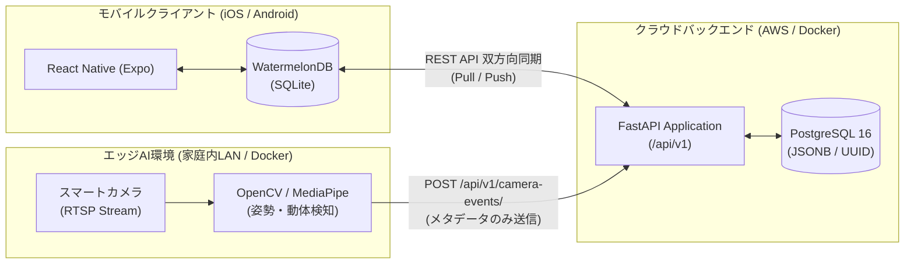
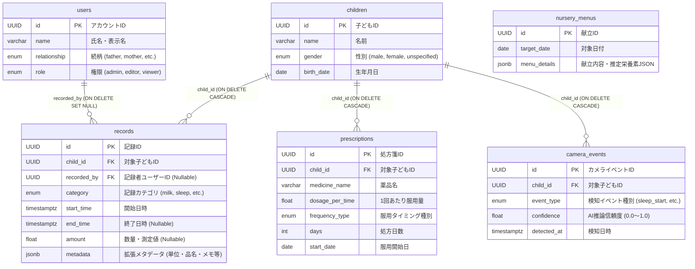

# KodomoTracker バックエンド基本設計書

## 1. はじめに

### 1.1 システム目的
**KodomoTracker** バックエンドは、日々の育児記録（授乳・離乳食・睡眠・排泄・体温・身体測定等）、処方箋・服薬管理、スマートカメラ（エッジAI）からの自動検知ログ、および保育園・学校の献立データを一元管理する RESTful API サーバーである。  
乳幼児期から青年期まで長期的に利用できる拡張性の高いスキーマ構造を持ち、モバイルクライアント（Expo / WatermelonDB）のオフラインファースト同期およびエッジAIコンテナからの Webhook 連携を支えるコア基盤として機能する。

### 1.2 対象範囲
本設計書は、`app/` および `alembic/` 配下に実装されたクラウドバックエンド（FastAPI / PostgreSQL）の基本設計を対象とする。

---

## 2. システムアーキテクチャ

### 2.1 全体構成図

### 2.2 技術スタック一覧

| 分類 | 採用技術 | バージョン / 仕様 | 採用理由 |
| :--- | :--- | :--- | :--- |
| 言語 | Python | 3.11+ | 型ヒント (`StrEnum`, `Mapped`) と AI エコシステムとの高い親和性 |
| Webフレームワーク | FastAPI | 0.110+ | 高速な非同期/同期処理、OpenAPI 自動生成、依存性注入 (DI) |
| バリデーション | Pydantic | v2 (`pydantic-settings` 含む) | Rust コアによる高速検証、`AliasChoices` による柔軟な JSON マッピング |
| ORM | SQLAlchemy | 2.0 (`Mapped` / `mapped_column`) | 厳密な型安全性と PostgreSQL 固有型 (`UUID`, `JSONB`) のネイティブサポート |
| データベース | PostgreSQL | 16 (Alpine) | `JSONB` による柔軟なメタデータ格納と高い信頼性 |
| DBドライバ | Psycopg | v3 (`psycopg[binary]`) | PostgreSQL 向けの次世代高速ドライバ |
| マイグレーション | Alembic | 1.13+ | スキーマバージョン管理と安全な DDL 適用 |
| コンテナ実行環境 | Docker / Docker Compose | 本番想定: AWS ECS/Fargate | 開発環境と本番環境のパリティ確保 |

---

## 3. データベース基本設計

### 3.1 設計方針
1. **UUID 主キーの採用**: 全テーブルの主キー (`id`) に `UUID v4` を採用し、モバイルクライアント側（WatermelonDB）でオフライン生成された ID との衝突を防止する。
2. **ハイブリッド・スキーマ (`JSONB` 活用)**: 検索軸となる基本属性（子どもID、カテゴリ、開始時刻、数量）はリレーショナルカラムとしてインデックスを貼り、カテゴリごとに異なる付加情報（単位、離乳食の品名、排泄種別、AI自動記録フラグ、献立栄養素など）は `JSONB` カラムに格納することで、乳幼児期〜高校生以降までの長期運用に耐える柔軟性を確保する。
3. **タイムゾーン付き日時**: 日時カラム（`start_time`, `end_time`, `detected_at`）は全て `DateTime(timezone=True)` (`TIMESTAMPTZ`) として保持する。

### 3.2 ER図（概念・論理モデル）

### 3.3 テーブル一覧

| テーブル物理名 | テーブル論理名 | 概要 | 主なリレーション |
| :--- | :--- | :--- | :--- |
| `users` | 家族・関係者アカウント | 親・祖父母・ベビーシッター等の記録者情報と権限を管理 | `records.recorded_by` から参照 |
| `children` | 子ども情報 | 記録対象となる子どもの基本プロフィール | `records`, `prescriptions`, `camera_events` の親 |
| `records` | 統合成長・生活ログ | 授乳・離乳食・睡眠・排泄・体温・身長・体重等の統合ログ | `children.id`, `users.id` を参照 |
| `prescriptions` | 処方箋・服薬マスタ | 処方薬の名称・用量・用法・日数を管理 | `children.id` を参照 |
| `camera_events` | エッジAI受信ログ | スマートカメラが検知した就寝・起床・寝返りイベント履歴 | `children.id` を参照 |
| `nursery_menus` | 保育園・学校献立データ | 日別の給食献立および推定栄養素データ（OCR解析結果等） | 独立マスタ（日付で紐付け） |

---

## 4. API 基本設計

### 4.1 エンドポイント設計方針
* **ベースパス**: `/api/v1`（環境変数 `API_V1_STR` で変更可能）
* **データ形式**: リクエスト・レスポンスともに `application/json`（UTF-8）
* **命名規則**: リソース名は複数形ケバブケース（例: `/camera-events`, `/nursery-menus`）
* **日時フォーマット**: ISO 8601 形式（例: `2026-11-05T08:30:00Z`）、日付は `YYYY-MM-DD`

### 4.2 エンドポイント一覧

| リソース | メソッド | パス | 機能概要 | 備考 |
| :--- | :--- | :--- | :--- | :--- |
| Health | `GET` | `/health` | コンテナ死活監視 (ECS/Fargate 用) | プレフィックスなし |
| Users | `POST` | `/api/v1/users/` | 家族・関係者アカウント新規作成 | `201 Created` |
| Users | `GET` | `/api/v1/users/` | アカウント一覧取得 (`skip`, `limit`) | |
| Users | `GET` | `/api/v1/users/{user_id}` | アカウント詳細取得 | 未存在時 `404` |
| Users | `PATCH` | `/api/v1/users/{user_id}` | アカウント部分更新 | |
| Users | `DELETE` | `/api/v1/users/{user_id}` | アカウント削除 | `204 No Content` |
| Children | `POST` | `/api/v1/children/` | 子ども情報新規作成 | `201 Created` |
| Children | `GET` | `/api/v1/children/` | 子ども一覧取得 (`skip`, `limit`) | |
| Children | `GET` | `/api/v1/children/{child_id}` | 子ども詳細取得 | 未存在時 `404` |
| Children | `PATCH` | `/api/v1/children/{child_id}` | 子ども情報部分更新 | |
| Children | `DELETE` | `/api/v1/children/{child_id}` | 子ども情報削除（関連レコードもカスケード削除） | `204 No Content` |
| Records | `POST` | `/api/v1/records/` | 育児・成長ログ新規作成 | `201 Created` |
| Records | `GET` | `/api/v1/records/` | 育児ログ一覧取得（`child_id`, `category` フィルタ対応） | `start_time` 降順 |
| Records | `GET` | `/api/v1/records/{record_id}` | 育児ログ詳細取得 | 未存在時 `404` |
| Records | `PATCH` | `/api/v1/records/{record_id}` | 育児ログ部分更新 | |
| Records | `DELETE` | `/api/v1/records/{record_id}` | 育児ログ削除 | `204 No Content` |
| Prescriptions | `POST` | `/api/v1/prescriptions/` | 処方箋データ新規作成 | `201 Created` |
| Prescriptions | `GET` | `/api/v1/prescriptions/` | 処方箋一覧取得（`child_id` フィルタ対応） | `start_date` 降順 |
| Prescriptions | `GET` | `/api/v1/prescriptions/{prescription_id}` | 処方箋詳細取得 | 未存在時 `404` |
| Prescriptions | `PATCH` | `/api/v1/prescriptions/{prescription_id}` | 処方箋部分更新 | |
| Prescriptions | `DELETE` | `/api/v1/prescriptions/{prescription_id}` | 処方箋削除 | `204 No Content` |
| Camera Events | `POST` | `/api/v1/camera-events/` | エッジAI検知イベント登録 | `201 Created` |
| Camera Events | `GET` | `/api/v1/camera-events/` | カメライベント一覧取得（`child_id` フィルタ対応） | `detected_at` 降順 |
| Camera Events | `GET` | `/api/v1/camera-events/{event_id}` | カメライベント詳細取得 | イミュータブルログ |
| Nursery Menus | `POST` | `/api/v1/nursery-menus/` | 保育園・学校献立データ登録 | `201 Created` |
| Nursery Menus | `GET` | `/api/v1/nursery-menus/` | 献立一覧取得（`target_date` フィルタ対応） | `target_date` 降順 |
| Nursery Menus | `GET` | `/api/v1/nursery-menus/{menu_id}` | 献立詳細取得 | 未存在時 `404` |
| Nursery Menus | `PATCH` | `/api/v1/nursery-menus/{menu_id}` | 献立データ部分更新 | |
| Nursery Menus | `DELETE` | `/api/v1/nursery-menus/{menu_id}` | 献立データ削除 | `204 No Content` |

---

## 5. 非機能要件・運用設計

1. **プライバシー保護（エッジAI連携）**:
   スマートカメラの映像フレーム自体は家庭内エッジAI（Dockerコンテナ）のメモリ上で即時破棄され、バックエンドには推論結果のメタデータ（`event_type`, `confidence`, `detected_at`）のみが送信される設計とする。
2. **可用性・起動耐障害性**:
   FastAPI の `lifespan` ハンドラで DB 接続失敗時も `OperationalError` をキャッチして警告ログを出力し、プロセス自体はクラッシュせずにヘルスチェック応答を維持できる設計とする。
3. **CORS 設定**:
   Expo Web やモバイル開発環境からのアクセスを許容するため、`CORSMiddleware` を標準搭載する。
4. **将来拡張（Phase 2 / Phase 3）**:
   * **Phase 2**: 音声アシスタント（Alexa / Siri / Google Assistant）からの Webhook を受け取り、LLM Structured Outputs で `RecordCreate` スキーマへ変換して保存するエンドポイントの追加。
   * **Phase 3**: `nursery_menus` と `records` を横断分析する栄養レコメンドエンジン、連絡帳ドラフト自動生成 API の追加。
