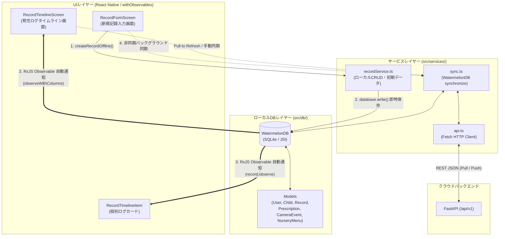
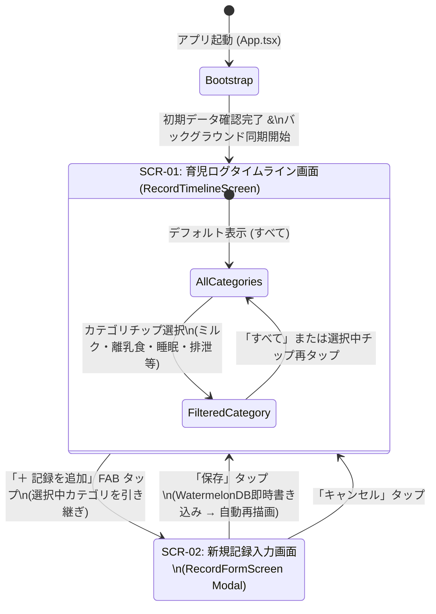

# KodomoTracker フロントエンド基本設計書

## 1. はじめに

### 1.1 システム目的
**KodomoTracker** フロントエンド（モバイルクライアント）は、「日々の育児記録の摩擦を極限まで減らす」ことを目的とした iOS / Android クロスプラットフォーム対応アプリケーションである。  
夜間の授乳や電波状況の不安定な屋内・外出先でも **0ミリ秒の待ち時間（オフラインファースト）** で即座に記録・閲覧できるよう、ローカルデータベース **WatermelonDB (SQLite)** を信頼の起点（Single Source of Truth）とし、バックグラウンドで FastAPI バックエンドと双方向同期を行うアーキテクチャを採用する。

### 1.2 対象範囲
本設計書は、`frontend/` ディレクトリ配下（`frontend/App.tsx` および `frontend/src/`）に実装された Expo (React Native / TypeScript) モバイルアプリケーションの基本設計を対象とする。

---

## 2. アーキテクチャ設計

### 2.1 オフラインファースト・リアクティブアーキテクチャ

### 2.2 技術スタック一覧

| 分類 | 採用技術 | バージョン | 採用理由 |
| :--- | :--- | :--- | :--- |
| フレームワーク | React Native (Expo) | Expo SDK 51 / RN 0.74 | iOS / Android / Web の単一コードベース開発、将来的な Expo Widgets 拡張性 |
| 言語 | TypeScript | 5.3+ (`strict: true`) | バックエンドのスキーマ・Enum と1対1で整合する型安全性の担保 |
| ローカルDB | WatermelonDB (`@nozbe/watermelondb`) | 0.27+ | SQLite + JSI による高速クエリ、遅延読み込み、リアクティブ Observable 機構 |
| リアクティブバインディング | `@nozbe/with-observables` / `rxjs` | 1.6+ / 7.8+ | DB変更を検知して必要なコンポーネントのみを自動再描画するため |
| トランスパイラ | Babel (`@babel/plugin-proposal-decorators`) | 7.24+ (`legacy: true`) | WatermelonDB のモデルデコレータ (`@field`, `@date`, `@relation`, `@writer`) 解決用 |

---

## 3. 画面構成・画面遷移設計

### 3.1 画面一覧

| 画面ID | 画面物理名 | 画面論理名 | 主な機能 |
| :--- | :--- | :--- | :--- |
| `NAV-00` | `App` (Header Navigation) | グローバルヘッダーメニュー | 画面上部に「タイムライン」「グラフ・成長曲線」「設定・管理」のメニューを配置。ブラウザ横幅が狭い場合（`< 720px`）は三本線のハンバーガーアイコンに切り替え、タップでドロップダウンメニューを展開 |
| `SCR-01` | `RecordTimelineScreen` | 育児ログタイムライン画面 | 子どもの日々の記録一覧表示、カテゴリ別フィルタリング、記録カードクリックによる編集起動、スマートカメラ検知バナー表示、クラウド同期トリガー、記録削除（赤文字表示） |
| `SCR-02` | `RecordFormScreen` | 記録入力・編集画面 (Modal) | ワンタップ家庭内ルール入力（プリセット）、カテゴリ選択、数量・単位・継続時間・開始時刻・品名（「ミルク・授乳」「離乳食」「食事」のみ表示）・メモ入力、ローカルDBへの新規保存および既存記録の編集・変更検知による「更新」反映、赤文字「キャンセル」ボタン |
| `SCR-03` | `AnalyticsScreen` | グラフ・成長曲線画面 | 5項目成長曲線、食事・排泄週間タイムチャート（Microsoft Outlook予定表方式のマルチカラム重なり回避配置）、週間睡眠バーチャート、体温推移グラフ（子どものカラーテーマ・ライト/ダークモード対応） |
| `SCR-04` | `SettingsScreen` | 設定・プロフィール管理画面 | 子どもの登録・編集・削除・表示切替・**カラーテーマ設定**、家族・関係者ユーザーの追加・編集・削除・記録者切替・**ライトモード/ダークモード設定**、全削除・キャンセルボタンの赤文字統一 |

### 3.2 画面遷移図

---

## 4. ローカルデータベース (WatermelonDB) 基本設計

### 4.1 バックエンド (PostgreSQL) とのデータ型マッピング方針
WatermelonDB (SQLite) はカラム型として `string`, `number`, `boolean` の3種類をサポートする。そのため、FastAPI / PostgreSQL 側のデータ型を以下の規則でマッピングし、双方向同期時の整合性を担保する。

| PostgreSQL / FastAPI 型 | WatermelonDB カラム型 | 変換・格納ルール | 対象カラム例 |
| :--- | :--- | :--- | :--- |
| `UUID` (PK / FK) | `string` | クライアント側でも RFC 4122 UUID v4 を生成し、WatermelonDB の `id` としてそのまま共有 | `id`, `child_id`, `recorded_by` |
| `Enum` (`StrEnum`) | `string` | バックエンドと同一の Enum 文字列リテラルを保存 | `category`, `relationship`, `role`, `gender`, `event_type` |
| `DateTime(timezone=True)` | `number` | UTC エポックミリ秒 (`number`) として保存し、Model の `@date` デコレータで `Date` オブジェクトへ変換 | `start_time`, `end_time`, `detected_at` |
| `Date` | `string` | ISO 8601 日付文字列 (`YYYY-MM-DD`) として保存 | `birth_date`, `start_date`, `target_date` |
| `Float` / `Integer` | `number` | 数値としてそのまま保存 | `amount`, `dosage_per_time`, `days`, `confidence` |
| **`JSONB`** | **`string`** | **`JSON.stringify()` でシリアライズした文字列として保存**し、Model のゲッターでパースして参照 | **`records.metadata`**, **`nursery_menus.menu_details`** |

---

## 5. クラウド同期基本設計 (`src/services/sync.ts`)

### 5.1 同期タイミング
1. **アプリ起動時 (`App.tsx`)**: ローカルDB初期化完了直後に非ブロッキングで自動実行。
2. **新規記録保存時 (`RecordFormScreen.tsx`)**: ローカルDBへの即時書き込み完了後、バックグラウンドで非同期実行。
3. **手動同期・プルリフレッシュ時 (`RecordTimelineScreen.tsx`)**: ヘッダーの「🔄 同期」ボタンまたはリストの Pull-to-Refresh 操作時に実行。

### 5.2 オフライン時の振る舞い
* ネットワーク未接続時やサーバー停止時は、`syncDatabase()` 内で通信例外をキャッチし、ローカルDBの未同期フラグ（`syncStatus: 'created' | 'updated'`）を維持したまま通常動作を継続する。
* タイムライン上の各カードには「**ローカル保存**」（未同期）または「**同期済**」バッジを表示し、ユーザーにデータの保存状態を明示する。
* オンライン復帰後に再度 `syncDatabase()` が実行された際、未同期レコードが一括して FastAPI へ Push される。
