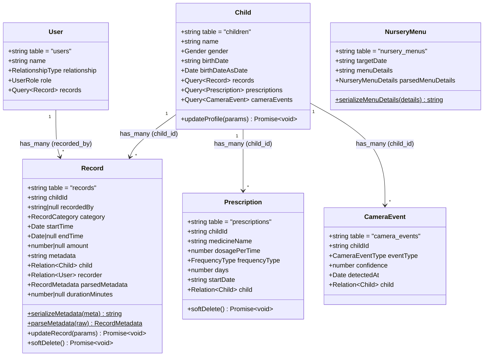
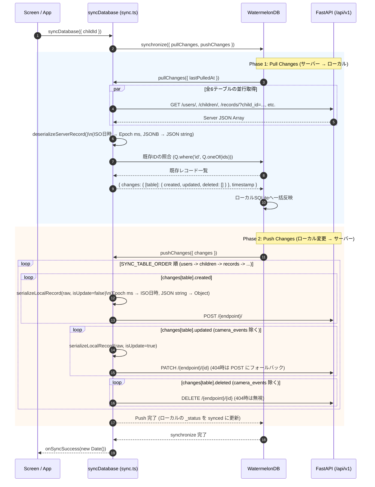

# KodomoTracker フロントエンド詳細設計書

## 1. ディレクトリ・ファイル構成

```text
/workspaces/KodomoTracker/frontend
├── App.tsx                                     # ルートコンポーネント (DatabaseProvider, 初期ブートストラップ, Modal制御)
├── app.json                                    # Expo アプリケーション設定
├── babel.config.js                             # @babel/plugin-proposal-decorators (legacy: true) 設定
├── package.json                                # Expo SDK 51 / WatermelonDB 0.27 / RxJS 依存定義
├── tsconfig.json                               # TypeScript コンパイラ設定 (experimentalDecorators: true, moduleSuffixes)
└── src/
    ├── types/
    │   ├── enums.ts                            # Enum定数・型定義、カテゴリ別UI設定マスタ (RECORD_CATEGORY_CONFIGS)
    │   └── index.ts                            # JSONBメタデータ型 (RecordMetadata, NurseryMenuDetails)
    ├── db/
    │   ├── index.ts                            # Database 初期化、UUIDv4 ジェネレータ設定、collections エクスポート
    │   ├── adapter.native.ts                   # iOS / Android ネイティブ環境用アダプタ (SQLiteAdapter + JSI)
    │   ├── adapter.web.ts                      # PCブラウザ (Web) 環境用アダプタ (LokiJSAdapter + IndexedDB)
    │   ├── schema.ts                           # kodomoTrackerSchema (version: 1, 全6テーブル定義)
    │   ├── migrations.ts                       # kodomoTrackerMigrations (スキーママイグレーション定義)
    │   └── models/
    │       ├── index.ts                        # modelClasses 配列エクスポート
    │       ├── User.ts                         # User モデル (users)
    │       ├── Child.ts                        # Child モデル (children)
    │       ├── Record.ts                       # Record モデル (records: JSON文字列シリアライズ・パース含む)
    │       ├── Prescription.ts                 # Prescription モデル (prescriptions)
    │       ├── CameraEvent.ts                  # CameraEvent モデル (camera_events)
    │       └── NurseryMenu.ts                  # NurseryMenu モデル (nursery_menus)
    ├── services/
    │   ├── index.ts
    │   ├── api.ts                              # ApiClient クラス (Fetch ラッパー、クエリ構築、ApiError)
    │   ├── sync.ts                             # syncDatabase()・シリアライズ/デシリアライズ・Pull/Push 実装
    │   └── recordService.ts                    # createRecordOffline, deleteRecordOffline, ensureInitialChildAndUser
    ├── components/
    │   ├── index.ts
    │   ├── CategoryFilterBar.tsx               # 横スクロール式カテゴリフィルタコンポーネント
    │   └── RecordTimelineItem.tsx              # withObservables 対応の個別育児ログカードコンポーネント
    └── screens/
        ├── index.ts
        ├── RecordTimelineScreen.tsx            # withObservables 対応のタイムライン表示画面
        └── RecordFormScreen.tsx                # オフラインファースト新規記録入力画面
```

---

## 2. 型・カテゴリ設定マスタ詳細設計 (`src/types/`)

### 2.1 カテゴリ設定マスタ (`RECORD_CATEGORY_CONFIGS` in `src/types/enums.ts`)

各 `RecordCategory` に対する画面表示ラベル・アイコン・デフォルト単位・入力項目制御フラグを以下のように定義する。

| カテゴリ値 (`RecordCategory`) | 表示ラベル (`label`) | アイコン | デフォルト単位 (`defaultUnit`) | 数量入力 (`hasAmount`) | 継続時間入力 (`hasDuration`) | アクセントカラー (`accentColor`) |
| :--- | :--- | :---: | :---: | :---: | :---: | :---: |
| `milk` | ミルク・授乳 | 🍼 | `ml` | `true` | `false` | `#FF8A65` |
| `baby_food` | 離乳食 | 🥣 | `g` | `true` | `false` | `#FFB74D` |
| `meal` | 食事 | 🍽️ | `g` | `true` | `false` | `#AED581` |
| `sleep` | 睡眠 | 🌙 | - | `false` | `true` | `#7986CB` |
| `excretion` | 排泄 | 🧷 | - | `false` | `false` | `#4DD0E1` |
| `body_temp` | 体温 | 🌡️ | `℃` | `true` | `false` | `#E57373` |
| `height` | 身長 | 📏 | `cm` | `true` | `false` | `#81C784` |
| `weight` | 体重 | ⚖️ | `kg` | `true` | `false` | `#64B5F6` |
| `custom` | その他 | 📝 | - | `true` | `false` | `#BA68C8` |

### 2.2 JSONB メタデータ型定義 (`src/types/index.ts`)

```typescript
export interface RecordMetadata {
  unit?: string;                                    // 単位 ("ml", "g", "℃", "cm", "kg" 等)
  item_name?: string;                               // 品名・メニュー名 (例: "和光堂ラタトゥイユ")
  note?: string;                                    // 自由記述メモ
  excretion_type?: 'pee' | 'poop' | 'both';         // 排泄種別 (おしっこ / うんち / 両方)
  is_auto_recorded?: boolean;                       // AI・音声アシスタント自動記録フラグ
  source?: 'manual' | 'voice_assistant' | 'edge_camera'; // 記録経路
  [key: string]: unknown;                           // 将来拡張フィールド許容
}
```

---

## 3. WatermelonDB データベース詳細設計 (`src/db/`)

### 3.1 スキーマ定義 (`src/db/schema.ts`)

スキーマバージョン `1` (`kodomoTrackerSchema`) における全6テーブルの物理カラム定義は以下の通りである。  
（※WatermelonDB 暗黙の主キー `id: string` および同期管理カラム `_status`, `_changed` は自動生成される）

#### (1) `users` テーブル
| カラム名 | WatermelonDB型 | `isOptional` | `isIndexed` | 対応バックエンド型 |
| :--- | :--- | :---: | :---: | :--- |
| `name` | `string` | `false` | `false` | `String(255)` |
| `relationship` | `string` | `false` | `false` | `Enum(RelationshipType)` |
| `role` | `string` | `false` | `false` | `Enum(UserRole)` |
| `theme_mode` | `string` | `true` | `false` | `String(16)` (`light` / `dark`) |

#### (2) `children` テーブル
| カラム名 | WatermelonDB型 | `isOptional` | `isIndexed` | 対応バックエンド型 |
| :--- | :--- | :---: | :---: | :--- |
| `name` | `string` | `false` | `false` | `String(255)` |
| `gender` | `string` | `false` | `false` | `Enum(Gender)` |
| `birth_date` | `string` | `false` | `false` | `Date` (`YYYY-MM-DD`) |
| `color_theme` | `string` | `true` | `false` | `String(32)` (`blue` / `pink` / `emerald` / `orange` / `purple` / `teal`) |

#### (3) `records` テーブル
| カラム名 | WatermelonDB型 | `isOptional` | `isIndexed` | 対応バックエンド型 |
| :--- | :--- | :---: | :---: | :--- |
| `child_id` | `string` | `false` | **`true`** | `UUID` (FK -> `children.id`) |
| `recorded_by` | `string` | **`true`** | **`true`** | `UUID` (FK -> `users.id`) |
| `category` | `string` | `false` | **`true`** | `Enum(RecordCategory)` |
| `start_time` | `number` | `false` | **`true`** | `DateTime(timezone=True)` (エポックms) |
| `end_time` | `number` | **`true`** | `false` | `DateTime(timezone=True)` (エポックms) |
| `amount` | `number` | **`true`** | `false` | `Float` |
| `metadata` | **`string`** | `false` | `false` | **`JSONB` (JSON文字列として格納)** |

#### (4) `prescriptions` テーブル
| カラム名 | WatermelonDB型 | `isOptional` | `isIndexed` | 対応バックエンド型 |
| :--- | :--- | :---: | :---: | :--- |
| `child_id` | `string` | `false` | **`true`** | `UUID` (FK -> `children.id`) |
| `medicine_name` | `string` | `false` | `false` | `String(255)` |
| `dosage_per_time` | `number` | `false` | `false` | `Float` |
| `frequency_type` | `string` | `false` | `false` | `Enum(FrequencyType)` |
| `days` | `number` | `false` | `false` | `Integer` |
| `start_date` | `string` | `false` | `false` | `Date` (`YYYY-MM-DD`) |

#### (5) `camera_events` テーブル
| カラム名 | WatermelonDB型 | `isOptional` | `isIndexed` | 対応バックエンド型 |
| :--- | :--- | :---: | :---: | :--- |
| `child_id` | `string` | `false` | **`true`** | `UUID` (FK -> `children.id`) |
| `event_type` | `string` | `false` | `false` | `Enum(CameraEventType)` |
| `confidence` | `number` | `false` | `false` | `Float` |
| `detected_at` | `number` | `false` | **`true`** | `DateTime(timezone=True)` (エポックms) |

#### (6) `nursery_menus` テーブル
| カラム名 | WatermelonDB型 | `isOptional` | `isIndexed` | 対応バックエンド型 |
| :--- | :--- | :---: | :---: | :--- |
| `target_date` | `string` | `false` | **`true`** | `Date` (`YYYY-MM-DD`) |
| `menu_details` | **`string`** | `false` | `false` | **`JSONB` (JSON文字列として格納)** |

---

### 3.2 モデルクラス設計 (`src/db/models/`)



#### `Record` モデル (`src/db/models/Record.ts`) の JSONB 文字列変換仕様
* **`Record.serializeMetadata(meta)`**:
  * 引数が `null` / `undefined` の場合は `'{}'` を返す。
  * 引数がオブジェクト（`RecordMetadata`）の場合は `JSON.stringify(meta)` で文字列化する。
  * 引数が既に有効な JSON 文字列の場合はそのまま返し、非 JSON 文字列の場合は `JSON.stringify({ note: meta })` として安全にラップする。
* **`Record.parseMetadata(raw)` / `record.parsedMetadata`**:
  * `this.metadata` 文字列を `JSON.parse()` でパースし、不正な JSON やプリミティブ値だった場合でも例外を投げずに空オブジェクト `{}` を返す防御的実装としている。

### 3.3 UUID v4 ジェネレータ設定 (`src/db/index.ts`)
WatermelonDB のデフォルト ID 生成器は16文字の英数字ランダム文字列を生成するが、バックエンドの PostgreSQL は `UUID` 型を要求する。  
そのため、`src/db/index.ts` の初期化時に `setGenerator(generateUuidV4)` を呼び出し、オフライン作成された全モデルの `id` が `xxxxxxxx-xxxx-4xxx-yxxx-xxxxxxxxxxxx` 形式の UUID v4 となるよう統一している。

### 3.4 プラットフォーム別 DB アダプタ自動解決設計 (`src/db/adapter.native.ts`, `src/db/adapter.web.ts`)
iOS / Android 実機・エミュレータ環境と、PCブラウザ（Expo Web）でのUI動作確認環境の双方で同一のアプリケーションコード（`src/db/index.ts` の `import { createDatabaseAdapter } from './adapter'`）を動作させるため、Metro Bundler および TypeScript (`moduleSuffixes`) のプラットフォーム拡張子解決機構を利用する。

| 対象プラットフォーム | 解決ファイル名 | 採用アダプタ | 永続化ストレージ / 特記事項 |
| :--- | :--- | :--- | :--- |
| **iOS / Android (Native)** | `src/db/adapter.native.ts` | `SQLiteAdapter` (`@nozbe/watermelondb/adapters/sqlite`) | 端末内 SQLite ファイル (`kodomo_tracker_db`) に永続化。`jsi: true` により C++ ブリッジ経由で高速クエリを実行。 |
| **PCブラウザ (Web)** | `src/db/adapter.web.ts` | `LokiJSAdapter` (`@nozbe/watermelondb/adapters/lokijs`) | ブラウザの **IndexedDB** (`kodomo_tracker_db`) に永続化 (`useIncrementalIndexedDB: true`, `useWebWorker: false`)。ネイティブ SQLite バイナリ不要でブラウザ単体動作を実現。 |

---

## 4. 同期サービス詳細設計 (`src/services/sync.ts`)

### 4.1 同期テーブル順序 (`SYNC_TABLE_ORDER`)
外部キー制約（`records.child_id -> children.id`, `records.recorded_by -> users.id`）の参照整合性を守るため、必ず以下の順序で Push 処理を行う。
1. `users` (`/api/v1/users/`)
2. `children` (`/api/v1/children/`)
3. `records` (`/api/v1/records/`)
4. `prescriptions` (`/api/v1/prescriptions/`)
5. `camera_events` (`/api/v1/camera-events/`)
6. `nursery_menus` (`/api/v1/nursery-menus/`)

### 4.2 双方向同期シーケンス図



### 4.3 データ変換関数仕様
* **`deserializeServerRecord(table, serverRecord)`**:
  * FastAPI レスポンス JSON を WatermelonDB の `RawSyncRecord` に変換。
  * `records.start_time` / `end_time` および `camera_events.detected_at` を `Date.parse()` でエポックミリ秒 (`number`) に変換。
  * `records.metadata` および `nursery_menus.menu_details` を `JSON.stringify` で文字列化。
* **`serializeLocalRecord(table, rawRecord, isUpdate)`**:
  * WatermelonDB の `RawRecord` を FastAPI の `Create` / `Update` ペイロードに変換。
  * エポックミリ秒を `new Date(value).toISOString()` で ISO 8601 文字列に変換。
  * `metadata` / `menu_details` 文字列を `JSON.parse()` で辞書オブジェクトへ変換。
  * `isUpdate === true` の場合は、FastAPI 側の `RecordUpdate` / `PrescriptionUpdate` スキーマ定義に合わせて `child_id` と `id` をペイロードから除外する。

---

## 5. UI コンポーネント・画面詳細設計 (`src/components/`, `src/screens/`)

### 5.1 `RecordTimelineScreen` (`src/screens/RecordTimelineScreen.tsx`)
* **Props (`RecordTimelineScreenProps`)**:
  * `childId: string`: 表示対象の子ども UUID
  * `onOpenCreateModal: (defaultCategory?: RecordCategory) => void`: 新規記録モーダル起動コールバック
  * `onEditRecord?: (record: RecordModel) => void`: タイムライン上の記録クリック（タップ）時の編集モーダル起動コールバック
* **State**:
  * `selectedCategory: RecordCategory | null`: 現在選択中のフィルタカテゴリ（`null` の場合は全件表示）
  * `isSyncing: boolean`: クラウド同期実行中フラグ
  * `lastSyncedAt: Date | null`: 最終同期成功日時
  * `syncErrorMessage: string | null`: オフライン状態メッセージ
* **`withObservables` バインディング (`ObservedRecordTimelineList`)**:
  * トリガー入力: `['childId', 'selectedCategory']`
  * 購読ストリーム:
    1. `child`: `collections.children.findAndObserve(childId)`
    2. `records`: `collections.records.query(...conditions, Q.sortBy('start_time', Q.desc)).observeWithColumns(['category', 'start_time', 'end_time', 'amount', 'metadata', 'recorded_by'])`
    3. `recentCameraEvents`: `collections.cameraEvents.query(Q.where('child_id', childId), Q.sortBy('detected_at', Q.desc), Q.take(3)).observe()`

### 5.2 `RecordTimelineItem` (`src/components/RecordTimelineItem.tsx`)
* **Props (`RecordTimelineItemExternalProps`)**:
  * `record: RecordModel`: 表示対象の育児ログモデルインスタンス
  * `onDelete?: (record: RecordModel) => void`: 削除ボタン押下時コールバック
  * `onPress?: (record: RecordModel) => void`: カードクリック（タップ）または「✏️ 編集」押下時コールバック
* **`withObservables` バインディング**:
  * `record: record.observe()`: レコード自体の変更および同期ステータス（`record.syncStatus`）の変化を監視。
  * `recorder: record.recordedBy ? record.recorder.observe() : of$(null)`: 記録者（`User`）名が変更された場合もリアクティブに反映。

### 5.3 `RecordFormScreen` (`src/screens/RecordFormScreen.tsx`)
* **Props (`RecordFormScreenProps`)**:
  * `childId: string`: 記録対象の子ども UUID
  * `recordedBy?: string | null`: 記録者ユーザー UUID
  * `initialCategory?: RecordCategory`: 初期選択カテゴリ（タイムラインのフィルタ状態を引き継ぎ）
  * `editingRecord?: RecordModel | null`: 編集対象の既存レコード（指定時は編集モードとして初期値を自動展開し、変更がある場合のみ「更新」ボタンを有効化）
  * `onSaved: () => void`: 保存・更新完了時コールバック（モーダルを閉じる）
  * `onCancel: () => void`: キャンセル時コールバック
* **ワンタップ家庭内ルールプリセット (`QUICK_PRESETS`)**:
  * 要件定義書に記載の家庭内ルール（例: `🥣 和光堂ラタトゥイユ (100g)`、`🍼 ミルク 160ml`、`🍼 ミルク 200ml`、`🌡️ 体温 36.6℃`）をワンタップでフォームへ自動セットする。
* **保存・更新処理フロー (`handleSave`)**:
  1. `startOffsetMinutes`（0分前 / 15分前 / 30分前 / 60分前）または日時指定入力から `startTime` を算出。
  2. `durationMinutesInput` が入力されている場合は `endTime` を算出。
  3. `unit`, `itemName`, `note`, `excretionType` を `RecordMetadata` オブジェクトに格納。
  4. 新規作成時は `createRecordOffline()`、編集モード時は `updateRecordOffline()` を呼び出し、`database.write()` トランザクション内でローカルDBへ即座に反映（この時点で `RecordTimelineScreen` および `AnalyticsScreen` の Observable が発火し画面が自動更新される）。
  5. 非同期（`void syncDatabase({ childId })`）でバックグラウンド同期を開始し、`onSaved()` で即座にモーダルを閉じる。

### 5.4 `AnalyticsScreen` における食事・排泄タイムチャートの重なり回避アルゴリズム (`layoutDayTimelineEvents`)
* 食事と排泄の記録タイミングが近い場合（例: 7:30のミルクと8:05のおしっこ等）にイベントバッジ同士が重なって見えにくくならないよう、Microsoft Outlookの予定表（Day/Weekビュー）と同様のアルゴリズムで配置を計算する：
  1. 24時間トラック（高さ 360px = 1440分）上の各イベントについて、バッジの視覚的占有高さに相当する時間幅（`VISUAL_SLOT_MINUTES = 90`分）の区間 `[effectiveStartMin, effectiveEndMin)` を算出して開始時刻順にソートする。
  2. 区間が互いに重なるイベント群を「衝突クラスタ（collision cluster）」としてグループ化する。
  3. クラスタ内の各イベントに対し、左から順に空いている列（`columnsEndMin[c] <= ev.effectiveStartMin`）を貪欲法で割り当て、クラスタの総列数 `totalCols` から水平位置 `leftPct = (colIndex / totalCols) * 100` と幅 `widthPct = (colSpan / totalCols) * 100` を決定する。

### 5.5 ヘッダーナビゲーション・レスポンシブハンバーガーメニュー・テーマ管理 (`App.tsx`, `src/theme/index.ts`, `SettingsScreen.tsx`)
* **ヘッダーメニュー & ハンバーガーアイコン (`App.tsx`)**:
  * フッターにあったナビゲーションメニュー（「📒 タイムライン」「📊 グラフ・成長曲線」「⚙️ 設定・管理」）を上部の `headerNav` に移動。
  * `useWindowDimensions()` により画面横幅を監視し、`width < 720` の狭幅時は三本線のハンバーガーアイコン（`hamburgerButton`）に切り替え、タップ時にドロップダウンメニュー（`hamburgerDropdown`）を展開する。
* **メニュー・品名入力欄の表示制御 (`RecordFormScreen.tsx`)**:
  * `showItemNameField = category === RecordCategory.MILK || category === RecordCategory.BABY_FOOD || category === RecordCategory.MEAL` により、「ミルク・授乳」「離乳食」「食事」以外の記録項目では「4. メニュー・品名 (`metadata.item_name`)」を非表示とする。
* **「削除」「キャンセル」の赤文字統一**:
  * アプリ内のすべての「削除」「キャンセル」ボタンのテキストカラーを `theme.dangerText`（ライトモード: `#DC2626`、ダークモード: `#F87171`）に統一。
* **子どものカラーテーマ & ユーザーのライト/ダークモード (`src/theme/index.ts`, `SettingsScreen.tsx`)**:
  * 子どもごとに6色のカラーテーマ（`blue`, `pink`, `emerald`, `orange`, `purple`, `teal`）、ユーザーごとに表示モード（`light`, `dark`）を WatermelonDB（Schema v2 マイグレーション対応）に保存し、`ThemeContext` (`useAppTheme()`) を通じて全画面の背景・カード・文字・アイコン・グラフ配色へ高コントラストで即時反映する。

---

## 6. 環境別画面表示（UI動作確認）・実行および配信設計

開発フェーズ（ローカル環境）から今後のテスト環境（Staging / QA検証環境）・本番環境（Production）まで一貫した方法で画面表示・UI動作確認を行えるよう、環境別の起動・配信方式および環境変数による接続先切り替え仕様を以下に定義する。

### 6.1 環境別構成・画面表示方式マトリクス

| 環境区分 | 確認媒体 / ターゲット | 画面表示・配信方式 | 起動・ビルドコマンド | アクセス先 / 確認方法 | ローカルDBアダプタ | バックエンド接続先 (`EXPO_PUBLIC_API_URL`) |
| :--- | :--- | :--- | :--- | :--- | :--- | :--- |
| **ローカル環境 (`local`)** | **PCブラウザ (Web)** | Metro Bundler Dev Server (`react-native-web`) | `npm run web`<br>（または `npx expo start --web`） | `http://localhost:8081` | `adapter.web.ts`<br>(IndexedDB) | デフォルト: `http://localhost:8000/api/v1`<br>（※バックエンド未起動でもオフライン動作可） |
| **ローカル環境 (`local`)** | **モバイル実機 / エミュレータ** | Expo Go / Development Build | `npm start`<br>（iOS: `npm run ios` / Android: `npm run android`） | QRコード読取（Expo Go）またはシミュレータ自動起動 | `adapter.native.ts`<br>(SQLite + JSI) | `http://<開発PCのLAN IP>:8000/api/v1` |
| **テスト・検証環境 (`staging` / `test`)** *(将来拡張)* | **PC / モバイルブラウザ (Web)** | 静的Webビルドホスティング (Cloud Run / Cloudflare Pages / Vercel 等) | `npx expo export --platform web`<br>（出力先: `dist/`） | `https://stg-app.kodomotracker.example.com` | `adapter.web.ts`<br>(IndexedDB) | `https://stg-api.kodomotracker.example.com/api/v1` |
| **テスト・検証環境 (`staging` / `test`)** *(将来拡張)* | **検証用 iOS / Android 端末** | EAS Build (`preview` プロファイル) / EAS Update / TestFlight / Internal App Sharing | `eas build --profile preview --platform all`<br>または `eas update --branch staging` | 配布URL / QRコードから検証端末へインストールして画面表示 | `adapter.native.ts`<br>(SQLite + JSI) | `https://stg-api.kodomotracker.example.com/api/v1` |
| **本番環境 (`production`)** *(将来拡張)* | **PC / モバイルブラウザ (Web)** | 本番CDN・静的Webホスティング | `npx expo export --platform web` | `https://app.kodomotracker.example.com` | `adapter.web.ts`<br>(IndexedDB) | `https://api.kodomotracker.example.com/api/v1` |
| **本番環境 (`production`)** *(将来拡張)* | **ユーザー iOS / Android 端末** | App Store / Google Play ストア配信 + EAS Update (OTA) | `eas build --profile production --platform all`<br>`eas submit --platform all` | 各OSのアプリストアからインストールして画面表示 | `adapter.native.ts`<br>(SQLite + JSI) | `https://api.kodomotracker.example.com/api/v1` |

---

### 6.2 環境変数による接続先切り替え設計 (`src/services/api.ts`)

Expo 標準の `EXPO_PUBLIC_` プレフィックス付き環境変数（ビルド時および起動時にバンドルへ注入）を用い、コードを変更することなく環境ごとの API エンドポイントを切り替える。

```typescript
// src/services/api.ts
const DEFAULT_API_BASE_URL =
  (typeof process !== 'undefined' && process?.env?.EXPO_PUBLIC_API_URL) ||
  'http://localhost:8000/api/v1';
```

* **環境別 `.env` ファイル構成方針（拡張時）**:
  * `.env.development`（ローカル開発用）: `EXPO_PUBLIC_API_URL=http://localhost:8000/api/v1`
  * `.env.staging`（テスト環境用）: `EXPO_PUBLIC_API_URL=https://stg-api.kodomotracker.example.com/api/v1`
  * `.env.production`（本番環境用）: `EXPO_PUBLIC_API_URL=https://api.kodomotracker.example.com/api/v1`

---

### 6.3 各環境における画面表示・UI動作確認手順

#### 6.3.1 ローカル環境（PCブラウザでのUI動作確認）

本アプリはオフラインファースト設計（`adapter.web.ts` によるブラウザ IndexedDB 永続化）を採用しているため、**バックエンド（FastAPI / PostgreSQL）を起動していない状態でも、フロントエンド単体で全ての画面表示・新規記録作成・フィルタリング・削除のUI動作確認が可能**である。

1. **初回セットアップ（依存パッケージのインストール）**
   ```bash
   cd frontend
   npm install
   ```
2. **Web開発サーバーの起動**
   ```bash
   cd frontend
   npm run web
   ```
   * 内部で `expo start --web` が実行され、Metro Bundler が起動する。
   * 対話モード（`npm start`）で起動した場合は、ターミナル上で `w` キーを押下することで Web サーバーが有効化される。
3. **PCブラウザでの画面表示**
   * ブラウザで **`http://localhost:8081`** にアクセスする。
   * 初回アクセス時に `ensureInitialChildAndUser()` が自動実行され、初期サンプルデータ（お子さま「はるか」、保護者「ママ」、初期ミルク・離乳食記録）がブラウザの IndexedDB (`kodomo_tracker_db`) に投入されてタイムライン画面（`SCR-01`）が表示される。
4. **モバイル画面サイズ（レスポンシブ）およびローカルDBの確認・リセット方法**
   * **画面サイズ確認**: Chrome / Edge 等の開発者ツール（`F12` または `Ctrl+Shift+I` / `Cmd+Option+I`）を開き、デバイスツールバー（`Ctrl+Shift+M`）で iPhone / Pixel 等のビューポートに切り替えて確認する。
   * **ローカルDBデータの初期化**: 開発者ツールの「Application（アプリケーション）」タブ ＞「Storage」＞「IndexedDB」内の `kodomo_tracker_db` を削除してページをリロードすると、初期ブートストラップ状態から再検証できる。
5. **ローカルバックエンドと結合してクラウド同期（「同期済」バッジ）を確認する場合**
   * 別ターミナルで `docker compose up -d`（または `uvicorn app.main:app --reload --port 8000`）を起動した状態で、画面右上の「🔄 同期」ボタンをクリックすると、`http://localhost:8000/api/v1` と Pull/Push 同期が行われ、各記録カードのバッジが「**ローカル保存**」から「**同期済**」へ変化する。

#### 6.3.2 テスト環境（Staging / QA検証環境）での画面表示手順（将来拡張時）

1. **Web版プレビューによる画面確認（PC / スマホブラウザ共通）**
   * CI/CD またはローカルにてテスト環境用 API URL を指定して静的ファイルを出力する：
     ```bash
     EXPO_PUBLIC_API_URL=https://stg-api.kodomotracker.example.com/api/v1 npx expo export --platform web
     ```
   * 生成された `dist/` ディレクトリをホスティング環境（Cloudflare Pages / Vercel / Firebase Hosting / Nginx 等）にデプロイし、発行されたプレビューURLへブラウザからアクセスして画面表示を確認する。
2. **モバイル実機（iOS / Android）での画面確認**
   * `eas.json` の `preview` プロファイルにテスト環境用環境変数を定義し、社内検証用ビルド（Android APK / iOS AdHoc または TestFlight）を生成・配信する。
   * JSレイヤーのみのUI変更時は `eas update --branch staging` を実行し、Expo Go または開発ビルドアプリから QR コードを読み取ることで即座にテスト環境の画面を確認する。

#### 6.3.3 本番環境（Production）での画面表示・リリース手順（将来拡張時）

1. **Web版の本番公開**
   * 本番用環境変数（`EXPO_PUBLIC_API_URL=https://api.kodomotracker.example.com/api/v1`）を設定の上、`npx expo export --platform web` を実行し、本番 CDN / Web サーバーへ配信する。
2. **ネイティブアプリ版の本番リリース**
   * `eas build --profile production --platform all` により App Store (.ipa) / Google Play (.aab) 向けバイナリをビルドし、`eas submit` で各ストアへ提出する。
   * 軽微なUI改修・バグ修正時は `eas update --branch production` による OTA（Over-The-Air）アップデートを配信し、ストア審査を待たずに本番端末の画面表示を更新する。
