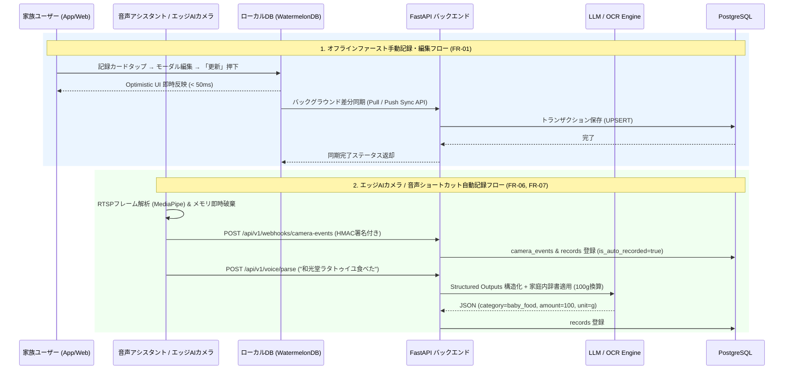

# 要件定義書: 次世代スマート育児・成長記録アプリ (KodomoTracker)

## 1. 概要 (Overview)

- **背景と課題 (Why)**:
  - 乳幼児期〜学童期の育児において、授乳・離乳食・睡眠・排泄・体温・身体測定・服薬などの記録は子どもの健康管理や保育園連携（連絡帳記入）に不可欠である一方、昼夜を問わない育児の中で手入力を行うこと自体が親・家族にとって大きな認知的・身体的負荷（摩擦）となっている。
  - また、スマートカメラや音声アシスタントを活用した自動化ニーズが高い反面、子どもの映像や健康データを外部クラウドへ無加工で送信することへの強いプライバシー懸念が存在する。
  - 既存の育児記録アプリは乳幼児期に特化したものが多く、小学生〜高校生以降の長期的な成長・健康プラットフォームとして継続利用しづらいという課題がある。
- **ビジネスゴール・目的**:
  - オフラインファーストな手動記録UI、OS音声アシスタント（Structured Outputsによる構造化）、および家庭内エッジAI（RTSPカメラ解析）を組み合わせ、日々の育児記録の摩擦を極限までゼロに近づける（入力時間を従来比70%以上削減）。
  - 映像ストリームをローカルメモリ内で即時破棄しメタデータのみを送信するハイブリッド・アーキテクチャにより、完全プライベートかつ安全な育児・成長アシスタントを実現する。
  - 蓄積された睡眠・食事・排泄・保育園献立データから、不足栄養素を考慮した次食レコメンドや連絡帳ドラフトのAI自動生成を行い、育児の意思決定と事務作業の負担を軽減する。
- **想定ユーザー (Target Users)**:
  - 親（父親・母親）、祖父母、ベビーシッターなど、子どもに関わる全ての家族・保育関係者（マルチデバイス・マルチロールでの共同利用およびロール別アクセス制御を想定）。
- **将来展望**:
  - 乳幼児期の育児記録にとどまらず、小学生〜高校生以降も長期的な健康・身体測定・服薬・学校行事管理プラットフォームとしてシームレスに継続活用できる拡張性の高いデータモデルを採用する。

---

## 2. スコープ (Scope)

- **In-Scope**:
  - **Phase 1 (コア基盤・UI/UX・分析可視化)**:
    - FastAPI + PostgreSQL (SQLAlchemy 2.0) によるバックエンドCRUD API構築と、React Native (Expo) + WatermelonDB / Expo SQLite によるオフラインファースト同期基盤。
    - タイムライン表示・新規記録作成・カードタップによるモーダル編集（「更新」ボタンによる差分反映）・論理/物理削除機能。
    - 記録カテゴリ連動の動的フォーム制御（`milk`, `baby_food`, `meal` の3カテゴリ選択時のみ `metadata.item_name` を表示）。
    - レスポンシブヘッダーナビゲーション（画面幅 `< 720px` でのハンバーガーメニュー自動折りたたみ）および破壊的・取消アクション（削除・キャンセル）の赤色カラーコード統一（Light: `#DC2626` / Dark: `#F87171`）。
    - 子どもプロフィール管理（複数人登録・編集・論理削除・ワンタップ表示切替・6色の子ども別UIカラーテーマとWCAG AAコントラスト維持）。
    - 家族・関係者アカウント管理（関係性・権限ロール `admin`/`editor`/`viewer`・記録者切替・ユーザー別 Light/Dark モード即時切替）。
    - 成長・生活リズムの高度可視化（身体5項目の月齢別標準発育目安帯付き成長曲線、Outlook予定表風マルチカラム衝突回避レイアウトを備えた食事・排泄の週単位タイムプロット、日跨ぎ自動分割対応の睡眠タイムバー、37.5℃基準線付き体温折れ線グラフ）。
  - **Phase 2 (IoT・エッジAI・音声入力・服薬管理)**:
    - Siri Shortcuts / Google Assistant / Amazon Alexa 経由の音声入力WebhookとLLM Structured Outputsによる構造化記録（家庭内ルール辞書に基づく自動グラム換算等）。
    - ローカルDockerコンテナ（Python + OpenCV + MediaPipe）によるRTSPカメラ解析（就寝・起床・寝返り・はいはい・立ち上がり検知）とWebhook連携。
    - 処方薬マスタサジェスト（インクリメンタルサーチ）機能および Notifee を用いたオフライン対応ローカル服薬リマインダー通知。
  - **Phase 3 (保育園・栄養レコメンド・外部カレンダー連携)**:
    - 保育園・学校献立表のOCR解析と家庭内食事履歴を掛け合わせた次食・不足栄養素レコメンドエンジン。
    - 睡眠・食事・排泄ログからの連絡帳提出用テキストAI自動生成（下書き保存機能）。
    - 日本の祝日（内閣府祝日データ / `jpholiday`）を自動除外した登園・送迎アラートと Google Calendar API 双方向同期。
- **Out-of-Scope**:
  - クラウド側へのカメラ映像・音声ファイル自体の録画・ストリーミング保存（プライバシー保護原則により厳禁）。
  - 医療診断・医療行為に該当する判定（体温や成長曲線はあくまで統計的目安・記録可視化として提供し、確定診断は行わない）。
  - 外部SNSへの公開共有機能（クローズドな家族・関係者間の共有に限定）。

---

## 3. 確認事項・不明点 (Clarifying Questions)

- [ ] **オフライン競合解決ポリシー**: 複数家族（例: 父親と母親）がオフライン状態で同時に同一の記録（`records.id`）を編集しオンライン復帰した場合、Last-Write-Wins（最終更新日時 `updated_at` 優先）とするか、フィールド単位のマージを行うか（現時点では `updated_at` による Last-Write-Wins + 監査ログ記録を標準仕様とする）。
- [ ] **音声・OCR・連絡帳生成のLLMプロバイダ選定**: 構造化抽出（Structured Outputs）および連絡帳下書き生成に利用するLLMは、クラウドAPI（OpenAI `gpt-4o-mini` / Gemini 2.5 Flash 等のゼロデータリテンション契約）を使用するか、自宅サーバー内のローカルLLM（Ollama / Llama 3 等）とのハイブリッド構成とするか。
- [ ] **医療用医薬品・市販薬サジェストのデータソース**: 服薬管理のインクリメンタルサーチ辞書として、PMDA（医薬品医療機器総合機構）や厚労省の薬価基準収載品目リストをベースにした初期マスタデータを同梱するか、家庭内で過去に処方された履歴＋主要小児薬マスタ（約2,000件）を初期バンドルするか。
- [ ] **成長曲線の標準発育目安データ基準**: 月齢別標準発育目安帯（3〜97パーセンタイル曲線）は、厚生労働省「乳幼児身体発育調査」および文部科学省「学校保健統計調査」の統計データを採用するか、WHO Child Growth Standards を併記するか。

---

## 4. 機能要件 (Functional Requirements)

### 4.1 機能一覧 (Feature List)

- **[FR-01] オフラインファースト基本記録・編集・削除管理**: 成長・生活記録（授乳・離乳食・食事・睡眠・排泄・体温・身体測定5項目・その他）のオフライン即時CRUD、タイムラインカードタップからの編集モーダル表示・差分検知による「更新」ボタン有効化、およびカテゴリ連動の動的フォーム制御。
- **[FR-02] レスポンシブナビゲーション＆アクセシビリティUI基盤**: ヘッダーナビゲーション（タイムライン・グラフ・設定）の配置、画面幅 `< 720px` でのハンバーガーメニュー自動切替、および破壊的・取消アクション（削除・キャンセル）の赤色文字統一。
- **[FR-03] 子どもプロフィール管理＆パーソナライズカラーテーマ**: 複数の子どもの登録・編集・論理削除・ワンタップ切替、および6色のカラーテーマ（ブルー・ピンク・グリーン・オレンジ・パープル・ティール）によるコントラスト維持型UI動的スタイリング。
- **[FR-04] 家族・関係者アカウント管理＆ライト/ダークモード切替**: 家族・関係者（親・祖父母・ベビーシッター等）のロール（`admin`, `editor`, `viewer`）管理、記録者切替、およびユーザー別ライト/ダークモードの即時反映。
- **[FR-05] 成長曲線・生活リズム可視化ダッシュボード**: 身体5項目（身長・体重・頭囲・胸囲・足のサイズ）の標準発育目安帯付き成長曲線、Outlook予定表風マルチカラム衝突回避を備えた食事・排泄の週単位タイムプロット、日跨ぎ分割対応の睡眠タイムバー、および37.5℃基準線付き体温グラフの描画。
- **[FR-06] 音声アシスタント連携＆LLM構造化記録**: Siri Shortcuts / Google Assistant / Alexa から送信された自然言語テキストを LLM Structured Outputs と家庭内ルール辞書で解析・単位換算し、`records` へ自動登録する機能。
- **[FR-07] スマートカメラRTSPエッジAI自動記録**: ローカルDockerコンテナ上の OpenCV + MediaPipe により RTSP 映像から「就寝・起床・寝返り・はいはい・立ち上がり」を検知し、フレームを即時破棄の上、メタデータのみをバックエンドへ Webhook 送信・記録する機能。
- **[FR-08] 服薬管理・薬品名サジェスト＆ローカル通知リマインダー**: 処方薬入力時のインクリメンタルサジェスト、服用スケジュール管理、および Notifee によるオフライン動作保証付きローカル通知。
- **[FR-09] 保育園献立OCR・栄養レコメンド＆連絡帳AIドラフト生成**: 献立表画像のOCR・栄養素推定と家庭内食事ログに基づく次食レコメンド、睡眠・食事・排泄データからの連絡帳提出用テキスト自動生成、および祝日除外送迎アラート・Google Calendar 双方向同期。

### 4.2 アーキテクチャ・データ連携フロー (Sequence Diagram)



### 4.3 詳細仕様 (Detailed Specs)

#### A. 基本記録・編集・動的フォーム仕様 ([FR-01])

- **対象カテゴリ (`records.category`)**:
  - 栄養・摂取系: `milk` (ミルク・授乳), `baby_food` (離乳食), `meal` (食事)
  - 生活・排泄・バイタル系: `sleep` (睡眠), `excretion` (排泄), `body_temp` (体温)
  - 身体測定5項目: `height` (身長), `weight` (体重), `head_circumference` (頭囲), `chest_circumference` (胸囲), `foot_size` (足のサイズ)
  - その他: `custom` (任意記録)
- **タイムライン編集モーダルと「更新」ボタン制御**:
  - タイムライン上の各記録カードをタップすると、対象レコードの既存値（カテゴリ、開始時刻、終了時刻、数量、メタデータ、メモ等）がプリセットされた状態で編集モーダルを開く。
  - モーダル初期表示時のフォーム状態スナップショットと現在の入力値をディープ比較（dirty check）し、1項目以上の変更があり、かつバリデーションを通過している場合のみ「更新」ボタンを活性化（`disabled=false`）する。
- **「4. メニュー・品名 (`metadata.item_name`)」の表示条件**:
  - 新規登録および編集モーダルにおいて、`category IN ('milk', 'baby_food', 'meal')` が選択されている場合のみ「4. メニュー・品名 (`metadata.item_name`)」入力フィールドをレンダリングする。
  - 上記以外のカテゴリ（`sleep`, `excretion`, `body_temp`, `height`, `weight`, `head_circumference`, `chest_circumference`, `foot_size`, `custom`）に切り替えられた場合はフィールドを即座に非表示とし、送信ペイロードから `metadata.item_name` を除外（または `null` クリア）する。
- **バリデーションルール**:
  - `start_time`: 必須。ISO 8601 (UTC / タイムゾーン付き)。
  - `end_time`: 任意。指定時は `end_time >= start_time` であること。
  - `amount`: 数値（Float）。カテゴリ別許容レンジ：
    - `milk` / `baby_food` / `meal`: `0.0 〜 2000.0` (ml / g)
    - `body_temp`: `32.0 〜 43.0` (℃、小数第1位まで)
    - `height`: `20.0 〜 220.0` (cm)
    - `weight`: `0.3 〜 150.0` (kg または g 換算)
    - `head_circumference` / `chest_circumference`: `20.0 〜 120.0` (cm)
    - `foot_size`: `5.0 〜 35.0` (cm)

#### B. ナビゲーション・レスポンシブ＆カラーアクセシビリティ仕様 ([FR-02], [FR-03], [FR-04])

- **レスポンシブヘッダーナビゲーション**:
  - 画面上部ヘッダーにメインナビゲーション項目（「タイムライン」「グラフ・成長曲線」「設定・管理」）および現在選択中の子どもバッジ・記録者バッジを配置する。
  - ビューポート横幅 `>= 720px`: メインメニュー3項目を水平タブバーとして常時展開表示する。
  - ビューポート横幅 `< 720px`: メインメニューを三本線のハンバーガーアイコンボタン（`aria-label="メニューを開く"`, タップ領域最小 `44x44px`）に折りたたみ、タップ時にドロップダウンメニューを開閉する。メニュー項目選択時または外側タップ時に自動で閉じる。
- **破壊的・取消アクションの視認性統一**:
  - アプリ内のすべての「削除」ボタン・アイコンおよびモーダル等の「キャンセル」ボタンのテキスト・アイコン色は、選択中の子どものカラーテーマに依存せず、以下のセマンティックカラーを強制適用する：
    - ライトモード (`theme_mode = 'light'`) 時: 文字色 **`#DC2626`** (Tailwind `red-600` 相当)
    - ダークモード (`theme_mode = 'dark'`) 時: 文字色 **`#F87171`** (Tailwind `red-400` 相当)
- **子ども別カラーテーマ（6色）とコントラスト維持**:
  - 設定可能な `color_theme`: `blue`, `pink`, `emerald` (グリーン), `orange`, `purple`, `teal`。
  - 選択中の子どもの `color_theme` に応じてプライマリボタン、アクティブタブ、バッジ、グラフ主線のアクセントカラーを動的に切り替える。
  - ユーザー別の `theme_mode` (`light` / `dark`) と掛け合わせた計12パターンのカラーパレットをトークン定義し、背景色と前景文字・アイコン・グラフ軸ラベルのコントラスト比が **WCAG 2.1 AA基準（通常テキスト 4.5:1 以上、UIコンポーネント・グラフ要素 3.0:1 以上）** を常に満たすよう明度を自動調整する。

#### C. 成長曲線・生活リズム可視化仕様 ([FR-05])

- **5項目の成長曲線 (`height`, `weight`, `head_circumference`, `chest_circumference`, `foot_size`)**:
  - 子どもの `birth_date` と `gender` に基づき、記録時点の月齢（生後日数 ÷ 30.4375）を横軸（X軸）、測定値を縦軸（Y軸）としてプロットする。
  - 背景に月齢別の標準発育目安帯（3パーセンタイル〜97パーセンタイルのポリゴン帯、および50パーセンタイル中央値破線）を描画し、その上に実測値の折れ線グラフを重ねて描画する。
- **食事・排泄の週単位タイムプロットグラフ（Outlook予定表風マルチカラム衝突回避アルゴリズム）**:
  - 指定した7日間（月〜日または直近7日間）を列、0:00〜24:00（1440分）を行とする2次元タイムグリッドを描画し、日別の回数・合計摂取量サマリを上部に表示する。
  - **衝突判定とマルチカラム分割ロジック**:
    1. 各イベントの表示占有時間枠を `[start_min, max(end_min, start_min + 30)]`（単発イベントも視認性確保のため最小30分枠相当の高さを割り当て）として算出する。
    2. 同一日内で時間枠が重なる（`EventA.start < EventB.end && EventB.start < EventA.end`）イベント群を連結成分（クラスタ）としてグループ化する。
    3. クラスタ内のイベントを開始時刻順にソートし、空いている最左カラムインデックス `col_idx (0 .. N-1)` を貪欲法（Greedy Column Packing）で割り当てる。
    4. クラスタの最大同時並列数を `N` としたとき、各イベントカードの横幅を `width = (100 / N)%`、左オフセットを `left = (col_idx * 100 / N)%` として配置し、食事（ミルク・離乳食・食事）と排泄（おしっこ・うんち・両方）が同時刻・近接時刻に記録されてもカード同士が重ならないようにする。
- **睡眠の週単位タイムバーグラフ**:
  - 7日間 × 0:00〜24:00 のガントバー形式で描画する。
  - **日跨ぎ睡眠の自動分割**: `start_time` と `end_time` が日付（`00:00:00` 本地時間）を跨ぐ場合（例: 前日 `21:30` 〜 当日 `06:30`）、前日分に `21:30〜24:00 (2.5h)`、当日分に `00:00〜06:30 (6.5h)` として自動分割描画し、日別合計睡眠時間および週平均睡眠時間（分単位集計→時間・分表示）を正確に算出する。
- **体温の折れ線グラフ**:
  - `category = 'body_temp'` の記録を時系列で折れ線プロットし、Y軸 `37.5℃` の位置に発熱目安の水平破線（警告色）を常時表示する。

#### D. 音声構造化・エッジAI・服薬・保育園連携仕様 ([FR-06] 〜 [FR-09])

- **音声コマンド構造化記録 ([FR-06])**:
  - エンドポイント `POST /api/v1/voice/records` にて音声認識テキストを受信し、Pydantic v2 スキーマを強制した LLM Structured Outputs で `category`, `amount`, `start_time`, `metadata` へ変換する。
  - 家庭内変換ルール（例: `"和光堂ラタトゥイユ"` → `category="baby_food"`, `amount=100.0`, `metadata={"unit": "g", "item_name": "和光堂ラタトゥイユ", "is_auto_recorded": true}`）をシステムプロンプトおよびDB辞書テーブルから注入する。
- **スマートカメラRTSPエッジAI ([FR-07])**:
  - エッジコンテナは RTSP ストリームを FPS 2〜5 に間引いてデコードし、メモリ（RAM）上の `numpy.ndarray` のみで MediaPipe Pose / Object Detection 推論を実行する。ディスク書き出し（録画）は一切行わず、推論直後にフレームバッファを破棄する。
  - 検知対象イベント：`sleepstart` (就寝), `sleepend` (起床), `rollover` (寝返り), `crawl` (はいはい), `standup` (立ち上がり)。信頼度スコア `confidence >= 0.75` かつ状態が一定秒数（姿勢系は3秒、睡眠系は180秒）継続した場合にデバウンス処理を経てクラウドAPIへ `HMAC-SHA256` 署名付き Webhook を送信する。
- **服薬サジェスト＆Notifee通知 ([FR-08])**:
  - 薬品名入力欄では2文字以上の入力（ひらがな・カタカナ・漢字対応、正規化検索）に対してデバウンス `200ms` で小児処方薬辞書をサジェスト表示する。
  - 処方登録時、`frequency_type`（`aftermeal`, `intervalhours`, `specifictime`）と `days` に基づき、Notifee の `TimestampTrigger` を用いて端末ローカル通知スケジュールを一括登録する（機内モード・圏外でも確実に発火）。
- **保育園連携・祝日除外送迎アラート ([FR-09])**:
  - 送迎アラートは平日指定時刻にスケジュールしつつ、日本の国民の祝日（`jpholiday` / 内閣府祝日CSV同期）および家庭別休園日カレンダーに該当する日は自動でアラート発火をスキップする。

### 4.4 エッジケース・異常系 (Edge Cases)

| ケース | 期待する挙動 | ステータスコード / UI挙動 |
| :--- | :--- | :--- |
| **権限不足ユーザーによる編集・削除** | `role = 'viewer'` のユーザーが記録の作成・更新・削除を試みた場合、UI側で操作ボタンを非活性または非表示とし、API直叩き時は拒否する。 | `403 Forbidden` (`{"code": "INSUFFICIENT_ROLE"}`) |
| **編集モーダルで未変更のまま保存試行** | 既存値から1箇所も変更がない状態では「更新」ボタンを `disabled` とし、不要なAPIリクエスト・DB更新を発行しない。 | UI側でボタン非活性 (`disabled=true`) |
| **カテゴリ変更時の `item_name` 残留** | 「離乳食」を選択して品名を入力後、保存前に「睡眠」や「身長」へカテゴリ変更した場合、品名入力欄を即時非表示にし、`metadata.item_name` を破棄して保存する。 | `200 OK` / `201 Created` (`item_name` は保存されない) |
| **同時刻に3件以上の食事・排泄が重複** | 例: `08:00` に「ミルク」「離乳食」「おしっこ」「うんち」の4件が記録された場合、週単位タイムプロットの該当時間帯を4カラム（各幅25%）に均等分割して横並び描画する。 | UI崩れ・重なりなし（最小カラム幅確保・タップで詳細ツールチップ表示） |
| **日跨ぎ睡眠・24時間超の長大記録** | 例: `21:00` から翌日 `07:00` までの睡眠記録は、前日 `21:00〜24:00` と当日 `00:00〜07:00` の2本のタイムバーに自動分割して集計する。終了時刻未入力（睡眠中）の場合は現在時刻までを暫定バー（点滅/破線）で表示する。 | 正常描画・日別睡眠時間を正確に按分集計 |
| **エッジAIからの重複Webhook送信** | カメラ検知の揺らぎにより同一イベント（例: `rollover`）が短時間に連続POSTされた場合、5分以内の同一 `child_id` + `event_type` は冪等キーまたはデバウンス判定で統合し、タイムラインのスパム化を防ぐ。 | `202 Accepted` (重複イベントはスキップまたは既存レコード更新) |
| **オフライン環境での記録・通知発火** | ネットワーク切断時はローカルDB（WatermelonDB / SQLite）へ `sync_status = 'pending'` で即時コミットし、Notifee ローカル通知もスケジュール通り発火させる。通信回復時に指数バックオフで自動同期する。 | ローカル即時完了 (`< 50ms`)・オンライン復帰時 `200 OK` |

---

## 5. 非機能要件 (Non-Functional Requirements)

### 5.1 セキュリティ・プライバシー (Security & Privacy)

- **プライバシー・バイ・デザイン（映像データの非保持）**:
  - エッジAIコンテナは RTSP ストリームのデコードフレームを揮発性メモリ（RAM）上でのみ扱い、ローカルストレージおよびクラウドストレージへの画像・動画保存を一切禁止する。
- **通信・認証・認可**:
  - クライアント〜クラウド間およびエッジAI〜クラウド間の全通信に **HTTPS (TLS 1.3)** を強制する。
  - ユーザー認証には JWT（Access Token 有効期限15分 + Refresh Token 30日・ローテーション付き）または OAuth 2.0 / Passkeys を用い、エッジAI Webhook には共有シークレットによる `X-Hub-Signature-256` (HMAC-SHA256) 署名検証とタイムスタンプ検証（リプレイ攻撃防止・許容誤差300秒以内）を必須とする。
  - ロールベースアクセス制御（RBAC）：
    - `admin`: 子ども・家族アカウントの追加/編集/削除、全設定変更、全記録のCRUDが可能。
    - `editor`: 記録の追加・編集・削除、および自身の表示モード（Light/Dark）切替が可能（子ども・家族マスタの削除は不可）。
    - `viewer`: タイムライン・成長曲線・グラフの閲覧、および自身の表示モード切替のみ可能。

### 5.2 パフォーマンス・オフライン耐性 (Performance & Offline First)

- **UI応答速度 (Optimistic UI)**:
  - ローカルDB（WatermelonDB / Expo SQLite）への書き込み・タイムライン反映・子ども切替・Light/Darkテーマ切替はすべて **50ms以内** にUIへ反映する。
- **APIレイテンシ**:
  - クラウドバックエンドの CRUD / Sync API の 95パーセンタイル応答時間（p95）を **200ms以内**（LLM推論を伴う音声構造化・連絡帳生成APIは **2,500ms以内**）とする。
- **グラフ描画パフォーマンス**:
  - 1子どもあたり累計 50,000件（約10〜15年分）の記録が存在する場合でも、インデックス走査と期間フィルタリングにより成長曲線および週単位グラフの初期描画を **300ms以内**（60fps維持）で完了させる。

### 5.3 可観測性・監査ログ (Observability)

- **構造化ログ & トレーシング**:
  - FastAPI バックエンドは JSON 形式の構造化ログ（`request_id`, `user_id`, `child_id`, `category`, `latency_ms`, `status_code`）を出力し、AWS CloudWatch Logs へ集約する。
- **記録変更監査**:
  - 家族間の共同記録における誤操作追跡のため、`records` テーブルには `recorded_by`（記録者）、`created_at`、`updated_at`、および論理削除フラグ `deleted_at` を保持する。

---

## 6. データモデル (Data Model)

長期的な運用（乳幼児〜青年期）および多様な関係者による共同記録・オフライン同期に対応した PostgreSQL 16 / SQLAlchemy 2.0 スキーマ定義。

```sql
-- 1. 家族・関係者アカウント (users)
CREATE TYPE user_relationship AS ENUM ('father', 'mother', 'grandfather', 'grandmother', 'babysitter', 'other');
CREATE TYPE user_role AS ENUM ('admin', 'editor', 'viewer');
CREATE TYPE theme_mode_type AS ENUM ('light', 'dark');

CREATE TABLE users (
    id UUID PRIMARY KEY DEFAULT gen_random_uuid(),
    name VARCHAR(100) NOT NULL,
    relationship user_relationship NOT NULL DEFAULT 'other',
    role user_role NOT NULL DEFAULT 'editor',
    theme_mode theme_mode_type NOT NULL DEFAULT 'light',
    created_at TIMESTAMPTZ NOT NULL DEFAULT NOW(),
    updated_at TIMESTAMPTZ NOT NULL DEFAULT NOW(),
    deleted_at TIMESTAMPTZ
);

-- 2. 子ども情報 (children)
CREATE TYPE child_gender AS ENUM ('male', 'female', 'unspecified');
CREATE TYPE child_color_theme AS ENUM ('blue', 'pink', 'emerald', 'orange', 'purple', 'teal');

CREATE TABLE children (
    id UUID PRIMARY KEY DEFAULT gen_random_uuid(),
    name VARCHAR(100) NOT NULL,
    gender child_gender NOT NULL DEFAULT 'unspecified',
    birth_date DATE NOT NULL,
    color_theme child_color_theme NOT NULL DEFAULT 'blue',
    created_at TIMESTAMPTZ NOT NULL DEFAULT NOW(),
    updated_at TIMESTAMPTZ NOT NULL DEFAULT NOW(),
    deleted_at TIMESTAMPTZ
);

-- 3. 統合成長・生活ログ (records)
CREATE TYPE record_category AS ENUM (
    'milk', 'baby_food', 'meal', 'sleep', 'excretion',
    'body_temp', 'height', 'weight', 'head_circumference',
    'chest_circumference', 'foot_size', 'custom'
);

CREATE TABLE records (
    id UUID PRIMARY KEY DEFAULT gen_random_uuid(),
    child_id UUID NOT NULL REFERENCES children(id) ON DELETE CASCADE,
    recorded_by UUID REFERENCES users(id) ON DELETE SET NULL,
    category record_category NOT NULL,
    start_time TIMESTAMPTZ NOT NULL,
    end_time TIMESTAMPTZ,
    amount DOUBLE PRECISION,
    -- metadata 例:
    -- 食事系: {"unit": "g", "item_name": "和光堂ラタトゥイユ", "is_auto_recorded": false, "notes": "完食"}
    -- 排泄系: {"excretion_type": "pee" | "poop" | "both", "condition": "normal", "notes": ""}
    -- その他: {"unit": "cm", "notes": "定期健診"} (※milk/baby_food/meal 以外では item_name を持たない)
    metadata JSONB NOT NULL DEFAULT '{}'::jsonb,
    created_at TIMESTAMPTZ NOT NULL DEFAULT NOW(),
    updated_at TIMESTAMPTZ NOT NULL DEFAULT NOW(),
    deleted_at TIMESTAMPTZ,
    CONSTRAINT chk_records_time_order CHECK (end_time IS NULL OR end_time >= start_time)
);

CREATE INDEX idx_records_child_time ON records (child_id, start_time DESC) WHERE deleted_at IS NULL;
CREATE INDEX idx_records_child_category_time ON records (child_id, category, start_time ASC) WHERE deleted_at IS NULL;
CREATE INDEX idx_records_metadata_gin ON records USING GIN (metadata);

-- 4. 処方箋・服薬マスタ (prescriptions)
CREATE TYPE prescription_frequency AS ENUM ('aftermeal', 'intervalhours', 'specifictime');

CREATE TABLE prescriptions (
    id UUID PRIMARY KEY DEFAULT gen_random_uuid(),
    child_id UUID NOT NULL REFERENCES children(id) ON DELETE CASCADE,
    medicine_name VARCHAR(200) NOT NULL,
    dosage_per_time DOUBLE PRECISION NOT NULL,
    frequency_type prescription_frequency NOT NULL,
    days INTEGER NOT NULL CHECK (days > 0 AND days <= 365),
    start_date DATE NOT NULL,
    schedule_details JSONB NOT NULL DEFAULT '{}'::jsonb, -- 例: {"times": ["08:00", "19:00"], "unit": "ml"}
    created_at TIMESTAMPTZ NOT NULL DEFAULT NOW(),
    updated_at TIMESTAMPTZ NOT NULL DEFAULT NOW()
);

-- 5. エッジAIからの受信ログ (camera_events)
CREATE TYPE camera_event_type AS ENUM ('sleepstart', 'sleepend', 'rollover', 'crawl', 'standup');

CREATE TABLE camera_events (
    id UUID PRIMARY KEY DEFAULT gen_random_uuid(),
    child_id UUID NOT NULL REFERENCES children(id) ON DELETE CASCADE,
    event_type camera_event_type NOT NULL,
    confidence DOUBLE PRECISION NOT NULL CHECK (confidence >= 0.0 AND confidence <= 1.0),
    detected_at TIMESTAMPTZ NOT NULL,
    linked_record_id UUID REFERENCES records(id) ON DELETE SET NULL,
    created_at TIMESTAMPTZ NOT NULL DEFAULT NOW()
);

CREATE INDEX idx_camera_events_child_detected ON camera_events (child_id, detected_at DESC);

-- 6. 保育園・学校献立データ (nursery_menus)
CREATE TABLE nursery_menus (
    id UUID PRIMARY KEY DEFAULT gen_random_uuid(),
    target_date DATE NOT NULL UNIQUE,
    menu_details JSONB NOT NULL DEFAULT '{}'::jsonb, -- 献立内容、推定栄養素（たんぱく質・鉄分・野菜量等）
    created_at TIMESTAMPTZ NOT NULL DEFAULT NOW(),
    updated_at TIMESTAMPTZ NOT NULL DEFAULT NOW()
);
```

---

## 7. 技術スタック (Tech Stack)

- **フロントエンド (モバイル・Webクロスプラットフォーム)**
  - **Framework**: React Native (Expo SDK 52+ / React Native Web 対応) / TypeScript 5.x
  - **Local Database (Offline-First)**: WatermelonDB または Expo SQLite (WALモード)
  - **Local Notification**: `@notifee/react-native` (オフライン環境下で動作するネイティブローカル通知)
  - **Native Extensions**: Expo Widgets (ホーム画面ウィジェット連携), Siri Shortcuts / Google Assistant App Actions / Alexa Custom Skill
- **エッジAI環境 (ローカルネットワーク内 / Windows Server上のLinux Docker)**
  - **Runtime & Vision**: Python 3.12, OpenCV (`opencv-python-headless`), MediaPipe (Pose / Object Detection)
  - **Streaming Input**: SwitchBot / Aqara 等のスマートカメラからのローカル RTSP ストリーム直接解析（メモリ内処理・即時破棄）
- **クラウドバックエンド (AWS環境)**
  - **API & Business Logic**: Python 3.12, FastAPI, Pydantic v2
  - **Database & ORM**: PostgreSQL 16, SQLAlchemy 2.0 (AsyncIO / `asyncpg`), Alembic (マイグレーション)
  - **AI / OCR / External API**: OpenAI API / Gemini API (Structured Outputs による音声構造化・献立OCR・連絡帳ドラフト生成), Google Calendar API, `jpholiday` (日本の祝日判定)
  - **Infrastructure**: AWS ECS on Fargate, Amazon API Gateway, Amazon EventBridge (バッチ処理・通知トリガー)

---

## 8. リスクと対策 (Risks & Mitigation)

| リスク項目 | 影響度 | 発生確率 | 具体的な対策 (Mitigation) |
| :--- | :---: | :---: | :--- |
| **スマートカメラ映像の流出リスク** | 極大 | 低 | エッジAIコンテナを家庭内LAN（ローカルDocker）に閉じ込め、外向き通信はバックエンドAPIへのメタデータPOSTのみに制限する。映像フレームをディスクへ書き出すコードパス自体を持たない設計とする。 |
| **エッジAIの誤検知・過検知（布団の揺れ等）** | 中 | 中 | `confidence >= 0.75` の閾値フィルタに加え、移動平均・状態継続時間によるデバウンス処理を導入する。また自動記録には `metadata.is_auto_recorded = true` バッジを付与し、タイムラインからワンタップで修正・削除可能にする。 |
| **音声認識の表記揺れ・単位誤変換** | 中 | 中 | LLM Structured Outputs のスキーマ制約に加え、家庭内でよく使う離乳食・ミルク銘柄（例：「和光堂ラタトゥイユ＝100g」）の変換辞書をプロンプトへ動的注入し、範囲外の異常値（ミルク5000ml等）はバリデーションで弾く。 |
| **子どものカラーテーマやダークモード切替時の視認性低下** | 中 | 高 | 6色の子どもテーマ × Light/Dark 2モードの全12パレットでコントラスト比（4.5:1以上）を事前定義し、「削除」「キャンセル」等の破壊的アクションはテーマ色に流されず常に赤色（`#DC2626` / `#F87171`）で固定表示する。 |
| **同時刻イベント集中によるグラフの重なり・視認性悪化** | 中 | 高 | 食事・排泄の週単位タイムプロットに Microsoft Outlook 予定表と同様の Greedy Column Packing（マルチカラム自動分割配置）アルゴリズムを実装し、イベントカード同士の重なりを構造的に排除する。 |

---

## 9. 開発ロードマップ (Development Roadmap)

- **Phase 1 (コア基盤・UI/UX・成長可視化)**:
  - FastAPI バックエンドのDB構築（PostgreSQL / SQLAlchemy 2.0）と CRUD API 実装。
  - React Native (Expo) による基本記録画面（動的フォーム制御・カードタップ編集モーダル・「更新」ボタン制御）、レスポンシブハンバーガーメニュー（`< 720px`）、赤色統一の削除/キャンセルUI、子どもプロフィール＆6色カラーテーマ管理、家族アカウント＆Light/Darkモード管理、ローカルDB同期処理の実装。
  - 5項目成長曲線、マルチカラム衝突回避対応の食事・排泄タイムプロット、日跨ぎ分割対応の睡眠タイムバー、体温折れ線グラフの実装。
- **Phase 2 (IoT & AI入力・服薬管理)**:
  - 音声ショートカット連携＋LLM Structured Outputs 実装。
  - エッジでの RTSP 解析コンテナ（OpenCV / MediaPipe）構築と Webhook 連携による `camera_events` / `records` への自動記録。
  - 処方薬インクリメンタルサジェストおよび Notifee ローカル通知リマインダーの実装。
- **Phase 3 (高度化・保育園＆外部連携)**:
  - 保育園献立表 OCR 解析と栄養レコメンドエンジン、連絡帳 AI ドラフト生成、Google Calendar 双方向同期・送迎通知（日本の祝日除外ロジック含む）の実装。
